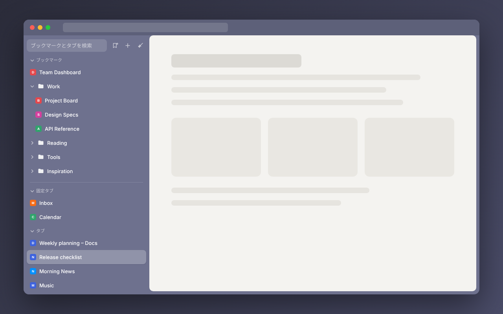

<!-- markdownlint-disable MD033 MD045 MD013 -->

  

<h1 align="center">Spinebar</h1>

  <strong>ブックマークとタブを、本棚の背表紙のように縦に並べる Chrome のサイドバー</strong>

  
  
  
  

---

## どんな拡張機能？

**Spinebar** は、Chrome のサイドパネルに、ブックマークと開いているタブを縦に並べて表示する拡張機能です。

- いつものブックマークを、フォルダごと縦のリストで開けます。
- 開いているタブも同じ場所に並ぶので、上のタブ列を探さなくても切り替えられます。
- Arc ブラウザのサイドバーに近い使い心地を目指しています。Arc から Chrome に乗り換える方にもおすすめです。

  

## 特徴

- **ブックマーク・固定タブ・タブの 3 つに整理**: セクションごとに見出しのクリックで開いたり閉じたりできます。
- **開いているタブへ自動で切り替え**: ブックマークをクリックしたとき、同じページがすでに開いていれば、新しいタブを増やさずにそのタブへ移ります。
- **ドラッグ＆ドロップで整理**: ブックマークの並べ替えやフォルダへの移動ができます。タブをドラッグすれば、その場所にブックマークとして追加されます。
- **まとめて検索**: ブックマークと開いているタブを、1 つの検索欄でまとめて絞り込めます。
- **タブをまとめて片付け**: ほうきボタンで、固定タブ以外のタブを一度に閉じられます。間違えても 5 秒以内なら元に戻せます。
- **データは外に出ません**: ブックマークやタブの情報は、お使いのパソコンの中だけで扱います。外部のサーバーには送りません。

## インストール

### Chrome ウェブストアから（準備中）

現在、Chrome ウェブストアへの公開を準備しています。公開後はこちらからインストールするのがおすすめです（自動でアップデートされます）。

### ダウンロードしてインストール

1. [ダウンロードページ](https://github.com/Libitech/spinebar/releases/latest) を開き、`spinebar.zip` をダウンロードします。
2. ダウンロードしたファイルをダブルクリックして展開します。展開してできた `spinebar` フォルダは、移動や削除をしない場所（書類フォルダなど）に置いてください。
3. Chrome のアドレスバーに `chrome://extensions` と入力して開きます。
4. 右上の **デベロッパーモード** をオンにします。
5. **パッケージ化されていない拡張機能を読み込む** を押し、手順 2 の `spinebar` フォルダを選びます。
6. ツールバーのパズルのアイコンから **Spinebar** の横のピンを押して、ツールバーに表示させます。

> **Note**: この方法で入れた場合、自動ではアップデートされません。新しい版が出たら、[アップデート](#アップデートと削除) の手順で入れ替えてください。

## 最初にやっておくこと

**サイドバーを左側に出す**

Chrome の設定で、サイドパネルを左側に出せます。

1. アドレスバーに `chrome://settings/appearance` と入力して開きます。
2. **サイドパネルの位置** を **左側に表示** にします。

**幅を変える**

サイドバーとページの境目をドラッグすると、幅を変えられます。変えた幅は Chrome が覚えています。

## 使い方

ツールバーの Spinebar のアイコンを押すか、`Alt + S` でサイドバーが開きます。

### よく使う操作

| やりたいこと | 方法 |
| --- | --- |
| ブックマークを開く | クリック（同じページが開いていれば、そのタブに切り替わります） |
| 裏で新しいタブに開く | `⌘ / Ctrl + クリック`、またはマウスのホイールでクリック |
| 今のタブで開く | `Shift + クリック` |
| 今のページをブックマークする | 検索欄の右のしおりボタン |
| 新しいタブを開く | 検索欄の右の ＋ ボタン |
| 固定タブ以外を全部閉じる | 検索欄の右のほうきボタン |
| セクションを開く / 閉じる | 「ブックマーク」「固定タブ」「タブ」の見出しをクリック |
| 検索する | 上の検索欄に入力（`Enter` で一番上を開く、`Esc` で消す） |

### 右クリックでできること

| 右クリックした場所 | できること |
| --- | --- |
| ブックマーク | 新しいタブで開く / すぐ下に新しいフォルダ / 名前を変更 / 削除 |
| フォルダ | このフォルダの中に新しいフォルダ / 名前を変更 / 削除 |
| タブ | タブを固定・固定を解除 / タブを複製 / タブを閉じる |
| 見出しや空いているところ | 新しいフォルダ / 新しいタブ |

- **フォルダを作る**: 作るとすぐに名前を入力できます。`Enter` で決定、`Esc` で作るのをやめます。
- **削除したとき**: 画面の下に「元に戻す」が 5 秒間出ます。押すと元の場所に戻ります（フォルダは中身ごと戻ります）。

### ドラッグ＆ドロップ

- ブックマークを上下にドラッグすると、並べ替えられます。
- フォルダの行の **まん中** に落とすと、そのフォルダの中に入ります。
- タブをブックマークの一覧にドラッグすると、その場所にブックマークが作られます。

### Chrome を起動したとき

Chrome を起動したあと、ページを最初にクリック（またはキー入力）したときに、サイドバーが自動で開きます。
Chrome のしくみ上、何も操作しないうちに開くことはできません。

## Arc から乗り換えるとき

Arc の「Pinned」に入れていたサイトは、ブックマークとして Chrome に移せます。

1. Arc でブックマークを書き出します（HTML ファイルになります）。
2. Chrome のメニューから **ブックマークと設定をインポート** を選び、そのファイルを読み込みます。
3. 読み込んだブックマークが、Spinebar の「ブックマーク」に表示されます。

| Arc | Spinebar |
| --- | --- |
| Pinned | ブックマーク |
| Today | タブ |

## プライバシーと権限

Spinebar は、ブックマークやタブの情報を **外部に送信しません**。すべてお使いのパソコンの中で処理します。
インストール時に表示される権限は、次の目的だけに使います。

| 権限 | 使い道 |
| --- | --- |
| ブックマーク | ブックマークの表示・追加・並べ替え・削除 |
| タブ | 開いているタブの一覧表示、切り替え、閉じる |
| サイドパネル | サイドバーとして表示する |
| ファビコン | サイトのアイコンを表示する |
| ストレージ | フォルダやセクションの開閉状態を覚えておく |
| すべてのサイトでの動作 | 起動後の最初のクリックで、サイドバーを自動で開くため（ページの内容は読み取りません） |

## FAQ

- **サイトのアイコンが地球儀のマークになる**
  Chrome でまだ一度も開いたことがないサイトは、アイコンが保存されていないため地球儀になります。一度そのページを開くと、次から正しく表示されます。表示が変わらないときは、サイドバーを閉じて開き直してください。
- **サイドバーが自動で開かない**
  新しいタブのページや設定画面など、`chrome://` で始まるページの上でのクリックでは開きません。普通のサイトを開いてクリックしてください。一度自分で閉じた場合は、次に Chrome を起動するまで自動では開きません。
- **右側に出てしまう**
  [最初にやっておくこと](#最初にやっておくこと) の手順で、左側に変更できます。
- **ブックマークが表示されない**
  ブックマークバーに入っているものと、「その他のブックマーク」の中身が表示されます。検索欄に文字が残っていないかも確認してください。

## アップデートと削除

- **アップデート（ダウンロード版）**: 新しい `spinebar.zip` をダウンロードして展開し、今の `spinebar` フォルダの中身と入れ替えます。そのあと `chrome://extensions` で Spinebar の更新ボタン（くるっとした矢印）を押します。
- **削除**: `chrome://extensions` で Spinebar の **削除** を押します。ブックマークは Chrome 本体のデータなので、削除しても消えません。

## ライセンス

© 2026 Libitech. All rights reserved.

Arc は The Browser Company の製品です。Spinebar は The Browser Company とは関係のない、独立した拡張機能です。
